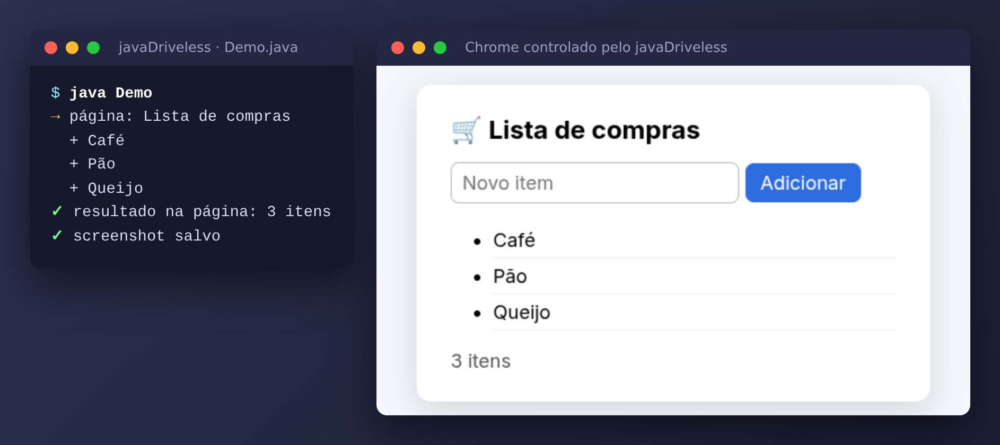

# Java Driverless

  

**In English:** Chrome automation for Java over the DevTools Protocol, no ChromeDriver needed, with persistent profiles, native input, cookies and multi-tab control.



*Um programa Java de poucas linhas controlando o Chrome por CDP: preenche a página, confere o resultado e salva o screenshot.*

Automação de navegador em Java pelo Chrome DevTools Protocol (CDP), sem ChromeDriver.
A biblioteca gerencia perfis do Chrome, navegação, entrada, cookies, JavaScript e
múltiplos alvos por meio de uma API Java.

Esta edição pública não contém perfis de navegador, cookies, credenciais,
configuração de proxy nem dados de projetos privados.

## Requisitos

- JDK 21 ou mais recente
- Maven 3.9 ou mais recente
- Google Chrome ou Chromium com uma tela de desktop para os testes de navegador

A suíte de testes padrão é determinística e exclui os testes marcados com `browser`,
`external` e `network`. Esses testes exigem um ambiente sob seu controle e
precisam ser habilitados explicitamente.

## Compilar a partir do código-fonte

```bash
git clone https://github.com/vitorcamillo/javaDriveless.git
cd javaDriveless
mvn -B -ntp clean test
mvn -B -ntp package
```

Coordenada: `io.github.vitorcamillo:javadriveless:2.0.0`.
A 2.0.0 renomeia a API `PhantomPass*` para `PhantoraPass*` (`applyPhantoraPass`, `SdkProfilePreset.PHANTORAPASS`
etc.) e quebra a compatibilidade de código; a 1.12.5 é a última versão com os nomes antigos.
A 1.12.5 endurece o catálogo de perfis (lock com prazo, escrita owner-only atômica, limites
anti-OOM) e corrige concorrência e timeouts da reauditoria, sobre as correções da 1.12.3.

## Início rápido

```java
import io.github.selenium.javaDriverless.JavaDriverless;

JavaDriverless driver = new JavaDriverless("example-profile");
try {
    driver.get("https://example.com");
    System.out.println(driver.getTitle());
} finally {
    driver.quit();
}
```

Os perfis podem conter cookies, armazenamento local e outros dados de sessão. Não
faça commit do diretório de perfis. Use perfis separados para contas separadas e
verifique os termos do serviço antes de automatizá-lo.

## Escopo e limitações

O Java Driverless usa um processo real do Chrome/Chromium e CDP. Ele não contorna
CAPTCHAs, proteções de contas, limites de requisição nem os termos de um site. As
opções de proxy e fingerprint são configurações explícitas da aplicação; as credenciais
devem ser fornecidas em tempo de execução por um gerenciador de segredos ou pelo ambiente,
e nunca devem entrar em commits. O comportamento do navegador depende do perfil
selecionado e do ambiente do host.

## Projeto relacionado

O MCP público de automação de redes sociais que usa esta biblioteca é mantido em
[`social-mcp`](https://github.com/vitorcamillo/social-mcp).

## Licença

O Java Driverless usa a licença MIT. Consulte [`LICENSE`](LICENSE) e
[`THIRD_PARTY_NOTICES`](THIRD_PARTY_NOTICES) para a atribuição ao projeto de origem.
